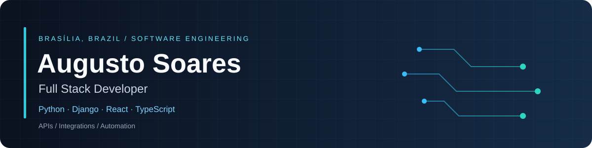

  

  

  
  
  

## About me

Full Stack Developer based in Brasília, Brazil, with professional experience in business and financial applications, APIs, integrations, and automation. My strongest professional stack is **Python/Django**; I also build projects with **Java/Spring Boot, C#/.NET, React, Angular, and Node.js**.

**Experience:** Dali — Python/Django and integrations · GIS Tecnologia — production business/financial systems · CAESB — automation and SQL Server · Bincom Global — C#/.NET volunteer work.

## Technologies

*Used across professional work, personal projects, and learning — not all in production.*

| Area | Technologies |
| --- | --- |
| Languages | Python, Java, C#, JavaScript, TypeScript, SQL, HTML, CSS |
| Backend | Django, Django REST Framework, Flask, Spring Boot, Spring Web, Spring Data JPA, ASP.NET Core, .NET, Node.js, NestJS, Express, tRPC |
| Frontend & mobile | React, Angular, React Native, Expo, Blazor, Razor, Tailwind CSS, Bootstrap, shadcn/ui, Framer Motion |
| UI & tooling | TanStack Query, React Hook Form, Zod, React Router, RxJS, Vite |
| Databases & persistence | PostgreSQL, SQL Server, MySQL, SQLite, Redis, Django ORM, Hibernate/JPA, EF Core, Prisma, Drizzle ORM, Flyway |
| Messaging & integrations | RabbitMQ, Kafka, Celery, REST, SOAP, HTTP/JSON, webhooks, transactional Outbox |
| Testing | Pytest, mocks/fixtures, JUnit, Mockito, xUnit, Moq, Testcontainers, Vitest, Testing Library, Playwright |
| Delivery & observability | Git, GitHub, GitHub Actions, Docker, Docker Compose, Postman, Swagger/OpenAPI, Prometheus, Grafana, OpenTelemetry, Jaeger, Serilog |
| Security & architecture | JWT, Spring Security, role-based access, OOP, Clean Architecture, layered design, dependency injection, microservices |
| Learning & AI tools | Kubernetes (lab), Spring Cloud Gateway, Eureka, Claude Code, Codex; AI changes reviewed and tested |

## Selected projects

- [**Automation Center**](https://github.com/Augustossn/automation-center) — Python/Django, React, PostgreSQL, Celery/Redis and Kafka.
- [**Credit Hub**](https://github.com/Augustossn/credit-hub) — Java/Spring Boot, React, PostgreSQL and RabbitMQ.
- [**MaintainFlow**](https://github.com/Augustossn/maintainflow) — C#/.NET, React, SQL Server and RabbitMQ.

*Personal portfolio projects, separate from professional experience.* [All repositories →](https://github.com/Augustossn?tab=repositories)

## Education & languages

ADS degree completed **May 2026** · Software Engineering postgraduate studies at **UCB**, since **October 2026**.  
**Portuguese:** native · **English:** C1 · Open to remote backend and full-stack opportunities.

Animation: [Readme Typing SVG](https://github.com/DenverCoder1/readme-typing-svg). Badges: [Shields.io](https://shields.io/).
